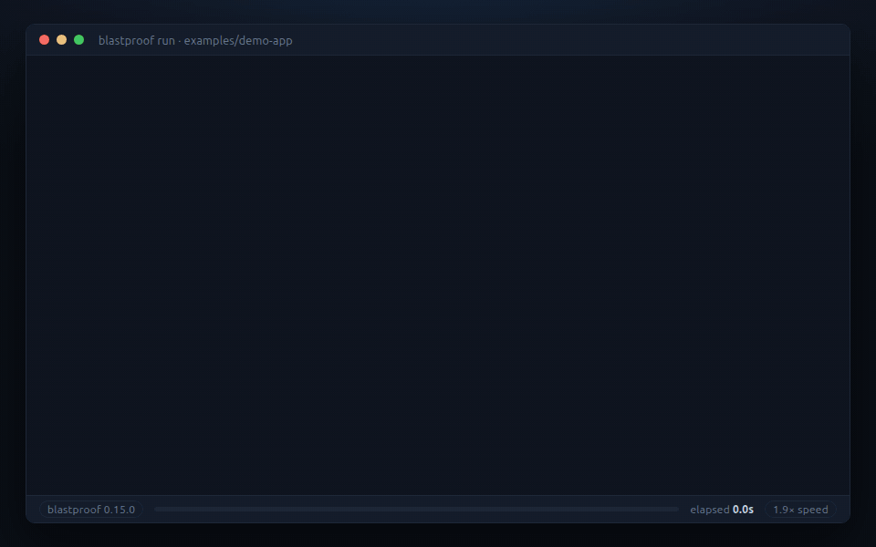

<h1>
  <picture>
    <source media="(prefers-color-scheme: dark)" srcset="https://raw.githubusercontent.com/hamc/blastproof/main/.github/logo-dark.svg">
    
  </picture>
  blastproof
</h1>

[](https://github.com/hamc/blastproof/actions/workflows/ci.yml)
[](https://github.com/hamc/blastproof/actions/workflows/dogfood.yml)
[](https://github.com/marketplace/actions/blastproof-e2e-ai-testing)
[](./LICENSE)

**Open-source AI testing agent for pull requests.** Write end-to-end tests in plain English. An agent runs them in a real browser, picks only the ones your diff can affect, and scores the result before merge.



▶ **[Watch the introduction](https://www.youtube.com/shorts/miqN5FzMF_k)** — what it does, in a minute.

## Why blastproof

- **Your tests live in your repository.** Plain-English YAML, reviewed in pull requests like code. No selectors to maintain: the agent reads the page the way a screen reader does.
- **It runs where your code runs.** On your machine or in your CI. No account, no subscription, no dashboard to sign in to. The only thing that leaves your network is the model call, to the provider you choose — or none, with a local model through Ollama. MIT licensed.
- **It costs cents, and you can cap it.** This repository's own 10-test suite takes about 110 model calls and 240k tokens per run on `claude-haiku-4.5`: about **$0.35 a run**, or 3–4 cents a test, at list prices. With `--impacted`, a pull request runs only the tests its diff can affect. A [budget](./docs/configuration.md#budget--bounding-what-a-run-spends) caps calls, tokens and time, and `--dry-run` costs nothing.
- **How often it is wrong is measured, not promised.** On this repository's benchmark, a seeded bug that should fail a test and a correct app that should pass it, both reference models got every verdict right in the latest measurement: 0 wrong in 89 runs on `claude-haiku-4.5` and 0 in 90 on `gpt-6-luna`. The demo app flatters, and the [method and its limits](./docs/reliability.md) are public.

**It fits best** when you cannot send your application to a hosted service, when you want tests as code rather than in someone else's UI, or when you already have an LLM key. **It does not fit yet** if your markup is not accessible, if your key journeys need drag and drop, file upload or several tabs, or if you are on Windows, which is untested. [Does this fit your application?](./docs/writing-tests.md#does-this-fit-your-application) has the details.

## Quick start

The fastest path is your coding agent, which can answer most setup questions by looking at your project:

```bash
npx skills add hamc/blastproof
```

Then tell your agent: **"set up e2e tests"**. The skill works with Claude Code, Cursor, Codex and others, and walks the whole path from checking your markup to a first green run. It leaves [authentication](./docs/auth.md) and [CI](./docs/ci.md) for after that run. It lives in [`skills/blastproof/`](./skills/blastproof/).

By hand:

```bash
npm install -g blastproof                     # Node.js >= 20.19
cd your-project
blastproof init                               # scaffolds .blastproof/; set base_url in its config.yaml
blastproof run --dry-run                      # checks the setup: no browser, no key

npx playwright install --with-deps chromium   # needs sudo; without it: npx playwright install chromium
export ANTHROPIC_API_KEY=...                  # or OPENAI_API_KEY, or a local Ollama
blastproof run
```

Before a run spends anything, it checks that the browser launches, the model provider answers and your app responds, and reports every problem at once with the command that fixes it. Providers, budgets and browser options: [Configuration](./docs/configuration.md).

## Writing tests

```yaml
summary: Checkout with discount
priority: P0
routes: ["/cart", "/checkout"]
steps:
  - add the Mechanical Keyboard to the cart
  - apply promo code SAVE20 and verify the total shows a 20% discount
  - complete checkout and verify the confirmation shows an order number
```

**Say what each step should produce.** A step that only names an action (`submit the form`) asks the judge whether something happened while it looks at a page that may have reset. A step that names its result (`submit the form and verify the task appears in the list`) gives it something to check. An outside evaluation took the same suite from Score 64 to Score 100 by rewriting two steps this way. The runner now judges an action step on a check that directly follows it, but a step that names its own result does not depend on that.

**A step that enters a value writes the value.** The agent is forbidden from inventing values: what it types must come from the step, the page or an `{{env.*}}` placeholder, and the runner refuses anything else rather than asking nicely. `run` warns about such steps before it starts; that check reads English only.

The full guide, including the accessibility requirement and what is not supported yet: [Writing tests](./docs/writing-tests.md).

## Commands

```bash
blastproof init                          # scaffold .blastproof/
blastproof run                           # run every test
blastproof run --impacted --base main    # run only what the diff can affect
blastproof plan --base main              # draft tests for routes no test covers
blastproof test --base main              # both: run what covers the diff, then draft the gaps
```

Exit codes: **0** pass, **1** the gate failed or the run stopped, **2** usage or config error. Flags, impact mapping, the score and the half that needs no browser or key: [Running, selecting and gating](./docs/running.md). Drafts from `plan` are never run or scored until you review and commit them.

## Learn more

- [Writing tests](./docs/writing-tests.md) — the rules that decide whether a suite works, and whether your app fits
- [Running, selecting and gating](./docs/running.md) — commands, `--impacted`, the score, and the free deterministic half
- [Configuration](./docs/configuration.md) — providers, models, budgets, browser, concurrency
- [Testing behind a login](./docs/auth.md) · [Running in CI](./docs/ci.md) — the GitHub Action is on the [Marketplace](https://github.com/marketplace/actions/blastproof-e2e-ai-testing)
- [Trust boundaries](./docs/trust-boundaries.md) — what the agent may reach, and how secrets stay out of prompts
- [How often a verdict is wrong](./docs/reliability.md) — the benchmark, and how to reproduce it

## Development

Built with AI assistance using spec-driven development: every change began as a written proposal with its design rationale, and `openspec/` keeps them, with the alternatives that were rejected and why. Start at [`AGENTS.md`](./AGENTS.md) and [`CONTRIBUTING.md`](./CONTRIBUTING.md). Open work lives in [issues](https://github.com/hamc/blastproof/issues).

```bash
npm install && npm run build && npm test
```

## License

[MIT](./LICENSE)
